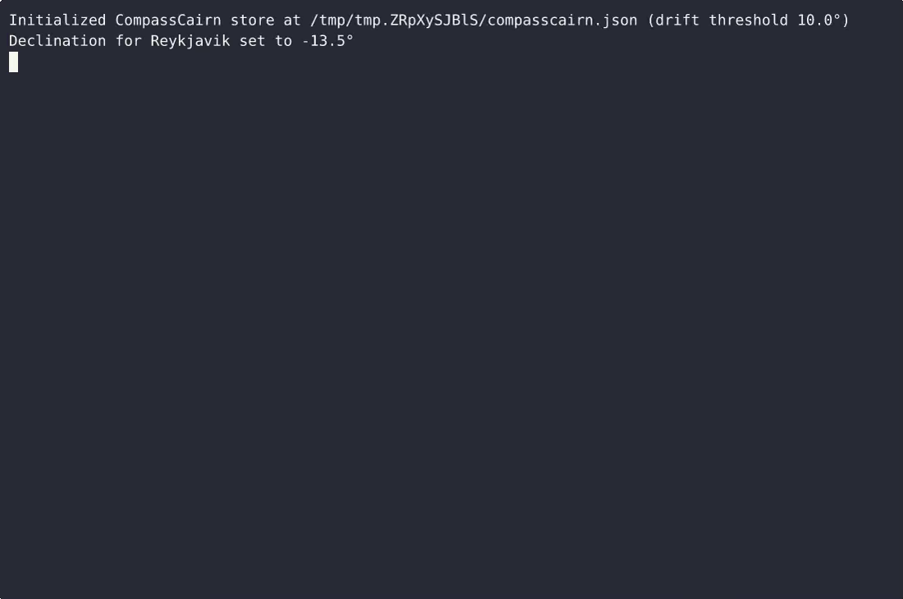
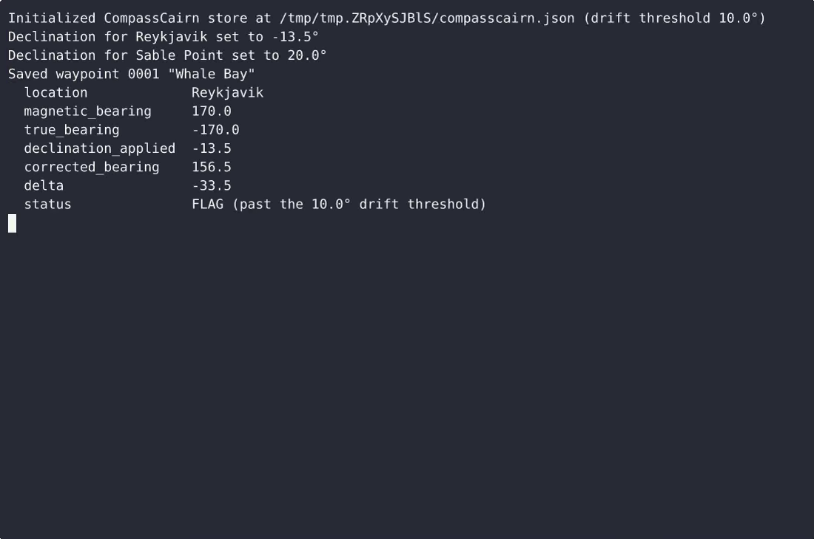

# CompassCairn — complete Full-stack app command-line tool example app

**CompassCairn** gives you two paths: self-host the Apache-2.0-licensed Full-stack app source as your own command-line tool, or [open it on cenius.ai](https://cenius.ai/marketplace/p/compasscairn?ref=gh&utm_campaign=compasscairn-webapp), describe the changes you want, and receive a new CompassCairn build with full rebrand rights. CompassCairn is a single-file, standard-library Python CLI that logs waypoint bearing corrections, stores magnetic declination per location, and flags any logged bearing whose correction exceeds a drift threshold. Everything ships in this repo — no paywall, no hidden features, no separate CompassCairn download.


[](LICENSE)  [](https://cenius.ai)

[](https://cenius.ai/marketplace/p/compasscairn?ref=gh&utm_campaign=compasscairn-webapp)

> **▶ [Open & edit in cenius.ai](https://cenius.ai/marketplace/p/compasscairn?ref=gh&utm_campaign=compasscairn-webapp)** — one click to an editable workspace: describe changes in plain English, get an instant preview, one-click deploy and host. Modifications made on the platform come with full rebrand & relicense rights.

_Local clone? See [Quick start](#quick-start) below. cenius.ai is the zero-setup path._

## Demo


📽 **[Demo video on cenius.ai](https://cenius.ai/marketplace/p/compasscairn?ref=gh&utm_campaign=compasscairn-webapp)** — the complete run-through · [MP4](.github/media/demo.mp4)

## Screenshots

 

## Usage guide

Every example below is real output. `python3 compasscairn.py` is abbreviated to `compasscairn`
(the console script `install.sh` installs); `COMPASSCAIRN_PASSPHRASE` is set so nothing prompts.

### 1. Create the store once

```bash
$ compasscairn init
Initialized CompassCairn store at ./compasscairn.json (drift threshold 10.0°)
```

The passphrase (8 characters minimum) is asked for twice unless `COMPASSCAIRN_PASSPHRASE` is set.
Only a salted scrypt hash and its salt land in the file:

```json
"kdf": { "name": "scrypt", "n": 16384, "r": 8, "p": 1, "salt": "356b0b4b47b608bf040bb342414a92fa" },
"passphrase_hash": "f81919af57ee708c6ed2b48fc65db75f670360d9253751607525ae8fa5a78e7e"
```

`init` refuses to clobber an existing store: `CompassCairn store already initialized` (exit 4).

### 2. Record magnetic declination per location

```bash
$ compasscairn declination set Reykjavik -13.5
Declination for Reykjavik set to -13.5°

$ compasscairn declination set "Sable Point" 20.0
Declination for Sable Point set to 20.0°

$ compasscairn declination list
LOCATION      DECL
-----------  -----
Reykjavik    -13.5
Sable Point   20.0

2 location(s) on file
```

Lookups are case-insensitive and spelling-stable: the first spelling wins as the display name,
and re-setting the same location updates that row in place.

```bash
$ compasscairn declination get reykjavik
Reykjavik  -13.5

$ compasscairn declination set reykjavik -14.0
Declination for Reykjavik updated to -14.0°

_Full guide: [`USAGE.md`](USAGE.md)_

## Features

- Log waypoint bearing corrections
- Store magnetic declination by location
- Flag bearings past a drift threshold

## Quick start

```bash
./install.sh   # installs dependencies + seeds demo data
```

See [`INSTALL.md`](INSTALL.md) for full setup and usage instructions.

## Architecture

Folder layout: `tests/`. The setup script (`install.sh`) installs runtime dependencies and loads a starter dataset so the app is immediately usable. Built in Full-stack app (12 files). See [`INSTALL.md`](INSTALL.md) for complete setup instructions.

## FAQ

### What's the quickest way to self-host CompassCairn?

Pull the repo, run `./install.sh`, and you are up — the script installs packages and pre-seeds the database. [`INSTALL.md`](INSTALL.md) covers any platform-specific tweaks.

### Is CompassCairn editable without a developer?

[cenius.ai](https://cenius.ai/marketplace/p/compasscairn?ref=gh&utm_campaign=compasscairn-webapp) handles the implementation. Tell it what you want in everyday words, pick up the updated build. No coding needed.

### Is it possible to white-label CompassCairn for a client?

Rebranding is straightforward under the MIT license — change what you want in the source. Or [open it on cenius.ai](https://cenius.ai/marketplace/p/compasscairn?ref=gh&utm_campaign=compasscairn-webapp): the platform handles the changes and grants full rebrand rights on the result.

### What is CompassCairn built with?

Full-stack app end-to-end. Every file you need to run the app is here in this repository — code, configuration, seed data. Highlights include store magnetic declination by location.

### What license does CompassCairn use?

Yes. The code is Apache-2.0-licensed — use it, modify it, and ship it commercially. See [LICENSE](LICENSE).

## License & rebranding

Released under the [Apache License 2.0](LICENSE) (© 2026 Cenius AI) — free for personal and commercial use. The Cenius name/logo are trademarks (see NOTICE).

**Need a customized version?** [Remix this app on cenius.ai](https://cenius.ai/marketplace/p/compasscairn?ref=gh&utm_campaign=compasscairn-webapp) — modifications made on the platform come with **full rebrand & relicense rights** over your derivative.

## Built with cenius.ai

This entire application — code, design, seeded demo data — was generated on **[cenius.ai](https://cenius.ai)** from a plain-English description.

- 🚀 [Build your own app on cenius.ai](https://cenius.ai)
- 🎛️ [Remix CompassCairn on the marketplace](https://cenius.ai/marketplace/p/compasscairn?ref=gh&utm_campaign=compasscairn-webapp) — open it in a workspace, prompt for changes, and ship your own version.

More open-source apps: [the Cenius-ai catalog](https://github.com/Cenius-ai) · [showcase index](https://github.com/Cenius-ai/showcase)
